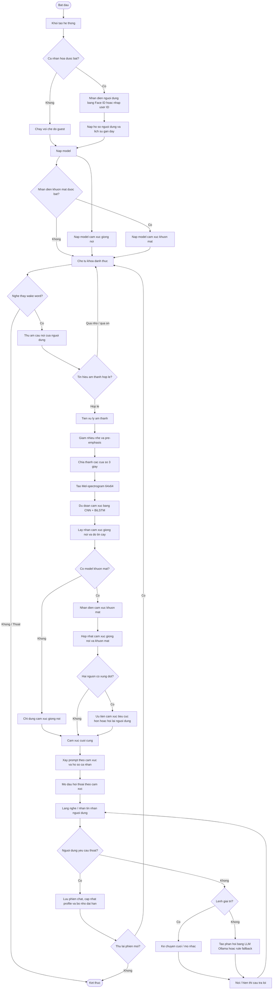
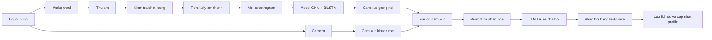
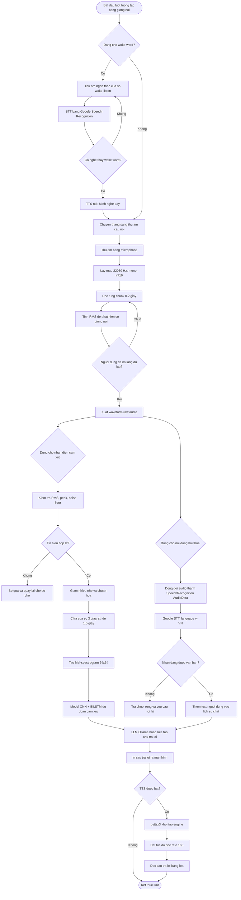

# Pipeline hoat dong cua chatbot MONE

## So do tong the

## Mo ta ngan gon

1. He thong khoi dong, doc cau hinh va xac dinh che do chay: chi giong noi hoac giong noi ket hop khuon mat.
2. Neu bat ca nhan hoa, chatbot nhan dien nguoi dung bang Face ID hoac yeu cau nhap user ID, sau do nap profile va cac phien hoi thoai gan day.
3. He thong nap model cam xuc am thanh tu `final_production_model.h5` va file nhan tu `label_mapping_final.pkl`. Neu bat nhan dien khuon mat, nap them model khuon mat.
4. Chatbot cho nguoi dung goi wake word, vi du `mone`, `mone oi`, `aura`, `aura oi`.
5. Khi duoc goi, chatbot thu am den khi nguoi dung im lang hoac dat thoi gian toi da.
6. Tin hieu am thanh duoc kiem tra chat luong bang RMS, peak va noise floor ratio. Neu qua nho hoac qua nhieu, he thong bo qua va quay lai che do cho.
7. Am thanh hop le duoc tien xu ly: giam nhieu nhe, chuan hoa bien do, chia cua so 3 giay, tao Mel-spectrogram kich thuoc 64x64.
8. Model CNN + BiLSTM du doan cam xuc giong noi theo 4 lop: `binhthuong`, `buon`, `gian`, `vui`.
9. Neu co model khuon mat, he thong du doan them cam xuc tu camera.
10. Module fusion hop nhat hai nguon cam xuc. Neu hai nguon dong y thi lay nhan do. Neu xung dot, he thong uu tien cam xuc tieu cuc hon hoac hoi lai nguoi dung de lam ro.
11. Cam xuc cuoi cung duoc dua vao prompt cua chatbot, ket hop voi profile, lich su gan day va bo nho dai han de tao ngu canh ca nhan hoa.
12. Chatbot phan hoi bang LLM Ollama. Neu cau lenh la giai tri, he thong xu ly truc tiep nhu ke chuyen cuoi hoac mo nhac.
13. Moi luot hoi thoai duoc luu vao session log. Khi ket thuc, he thong cap nhat profile, tom tat dinh ky va bo nho dai han.
14. Nguoi dung co the bat dau phien moi hoac ket thuc chuong trinh.

## Pipeline rut gon de ve tren slide

## Luong xu ly am thanh, STT va TTS

## Giai thich luong am thanh

1. Wake word: he thong thu cac doan am thanh ngan voi tan so `22050 Hz`, sau do dung STT de kiem tra nguoi dung co goi `mone`, `mone oi`, `aura` hoac `aura oi` hay khong.
2. Thu am cau noi: khi da duoc danh thuc, microphone ghi am theo tung chunk `0.2 giay`. He thong tinh RMS cua moi chunk de biet khi nao nguoi dung bat dau noi va khi nao da im lang.
3. Ket thuc thu am: neu nguoi dung im lang du `3.0 giay` sau khi da noi, hoac dat thoi gian toi da `15.0 giay`, he thong dung thu.
4. Nhan dien cam xuc: waveform duoc chuan hoa, giam nhieu nhe, chia thanh cac cua so `3.0 giay`, tao Mel-spectrogram `64 x 64`, roi dua vao model CNN + BiLSTM.
5. STT cho noi dung chat: cung audio dau vao duoc dong goi thanh `AudioData` va gui qua Google Speech Recognition voi ngon ngu `vi-VN` de lay text nguoi dung.
6. Tao phan hoi: text nguoi dung, cam xuc du doan va ngu canh ca nhan hoa duoc dua vao LLM Ollama hoac rule fallback.
7. TTS: cau tra loi duoc in ra man hinh; neu `VOICE_CHAT_TTS_ENABLED=True`, `pyttsx3` se doc cau tra loi qua loa voi toc do `rate=165`.

## Thong so chinh

- Tan so lay mau khi xu ly am thanh: `22050 Hz`.
- Thoi luong cua so am thanh cho model: `3.0 giay`.
- Buoc truot khi xu ly doan noi dai: `1.5 giay`.
- Kich thuoc anh Mel-spectrogram: `64 x 64`.
- So frame dau vao moi cua so: `10`.
- So lop cam xuc: `4` gom `binhthuong`, `buon`, `gian`, `vui`.
